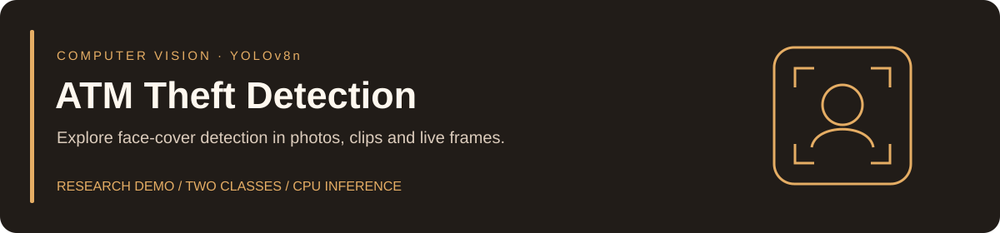
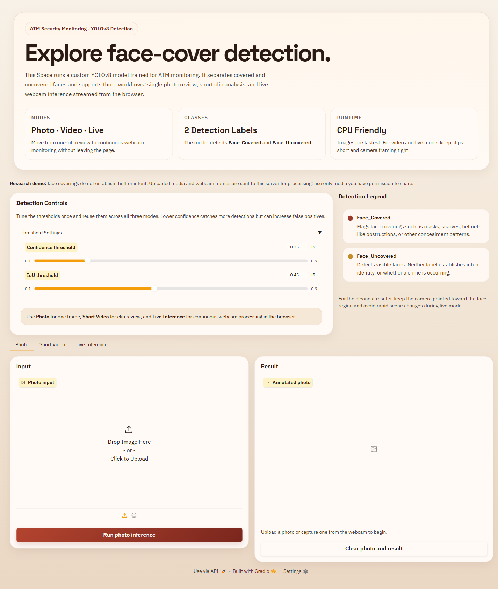

<p align="center"></p>

<p align="center">
  <a href="https://vaibhavsh0120-atm-theft-detection.hf.space"><strong>Open website ↗</strong></a> ·
  <a href="https://huggingface.co/spaces/Vaibhavsh0120/ATM-Theft-Detection">Hugging Face Space</a> ·
  <a href="https://huggingface.co/Vaibhavsh0120/ATM-Theft-Detection">Model &amp; weights</a> ·
  <a href="docs/publishing.md">Publishing guide</a>
</p>
<p align="center">
  <a href="https://github.com/Vaibhavsh0120/ATM-Theft-Detection/actions/workflows/ci.yml"></a>
  
  
</p>

A custom YOLOv8n detector that labels **Face_Covered** and **Face_Uncovered**, with a Gradio website for photo, short-video and browser-webcam inference. Includes dataset preparation, training/resume, optional INT8 TFLite export and Hugging Face publishing.

> **Scope:** this model detects face-cover patterns. It does not detect theft, establish intent or identify people. A covered face is not evidence of wrongdoing. This is a research demo, not a validated ATM alarm system.

## Try it

| Resource | Link / purpose |
| --- | --- |
| **Live website** | [Open the detector](https://vaibhavsh0120-atm-theft-detection.hf.space) |
| Space home | [App, source files and runtime status](https://huggingface.co/spaces/Vaibhavsh0120/ATM-Theft-Detection) |
| Space source | [Browse deployed app files](https://huggingface.co/spaces/Vaibhavsh0120/ATM-Theft-Detection/tree/main) |
| Model repository | [Model card and checkpoint](https://huggingface.co/Vaibhavsh0120/ATM-Theft-Detection) |
| Checkpoint | [Download weights/best.pt](https://huggingface.co/Vaibhavsh0120/ATM-Theft-Detection/resolve/main/weights/best.pt) |
| GitHub release | [Original checkpoint + SHA-256 checksum](https://github.com/Vaibhavsh0120/ATM-Theft-Detection/releases/tag/weights) |
| Dataset | [Roboflow Universe — version 4](https://universe.roboflow.com/vaibhav-7tcrm/atm-theft-detection-f8ezg/dataset/4) |
| Automation | [Checks](https://github.com/Vaibhavsh0120/ATM-Theft-Detection/actions/workflows/ci.yml) · [Manual Hub publishing](https://github.com/Vaibhavsh0120/ATM-Theft-Detection/actions/workflows/publish-hf.yml) |

The free CPU Space can sleep when idle; allow time to wake. Choose **Photo** for an image, **Short Video** for a clip up to **30 seconds / 25 MB**, or **Live Inference** for webcam frames. Allow camera access over HTTPS. Shared CPU capacity means video and live processing may be slower than playback.

Uploads and streamed frames are processed on the Space server. Use media you have permission to share. Outputs are temporary: Gradio expires its served cache hourly; source video outputs older than an hour are removed on the next video request. This is not an immediate-deletion guarantee.

<details>
<summary>Website preview</summary>



</details>

## Run the website locally

No Roboflow key, dataset download or training is needed: the checkpoint is included through Git LFS.

```bash
git lfs install
git clone https://github.com/Vaibhavsh0120/ATM-Theft-Detection.git
cd ATM-Theft-Detection
python -m venv .venv
```

Use **Python 3.11**. Activate the environment:

```powershell
# Windows PowerShell
.\.venv\Scripts\Activate.ps1
```

```bash
# macOS / Linux
source .venv/bin/activate
```

```bash
python -m pip install -r deploy/huggingface-space/requirements.txt
python deploy/huggingface-space/app.py
```

Open the local URL printed in the terminal, normally `http://127.0.0.1:7860`.

If the checkpoint is missing or reports a Git LFS pointer error, run `git lfs pull`.

## Train your own checkpoint

Install the separate training dependencies and copy `.env.example` to `.env`. Set `ROBOFLOW_API_KEY` to a private key with dataset access. Keep secrets out of Git.

```bash
python -m pip install -r training/requirements.txt
python training/scripts/bootstrap_assets.py
python training/scripts/remap_labels.py
python training/scripts/train_yolo.py --epochs 80
```

Bootstrap downloads and validates a fresh Roboflow export **before** replacing the previous dataset. Remapping validates all labels and the 21-class order, backs up originals under `.original-labels/`, and converts labels and dataset metadata to two classes. It refuses to remap twice. Training requires the completed remap marker.

```bash
# Resume the most recently modified last.pt
python training/scripts/train_yolo.py --resume

# Or resume an explicit checkpoint
python training/scripts/train_yolo.py --resume-from training/outputs/runs/detect/train2/weights/last.pt

# Desktop webcam inference (q to quit)
python training/scripts/run_live_inference.py
```

Fresh runs go to incrementing `training/outputs/runs/detect/train*/` folders. Desktop inference uses the latest local `best.pt`, falling back to the published model. Set `WEBCAM_INDEX` to choose another camera.

The default dependencies support CPU inference/training. For NVIDIA CUDA, install the matching PyTorch build using the [official installation selector](https://pytorch.org/get-started/locally/). See [training details and TFLite export](training/README.md).

## Publish to Hugging Face

```bash
python -m pip install huggingface_hub==1.9.2 python-dotenv==1.1.1
hf auth login
python scripts/push_hf.py --dry-run
python scripts/push_hf.py --bundle-space-model
```

Set `HF_MODEL_REPO_ID` and `HF_SPACE_REPO_ID` in `.env` or pass `--model-repo` and `--space-repo`. The destinations must already exist. Publishing adds normal commits, preserves history and unrelated remote files, excludes secrets/caches, and rejects concurrent remote edits. A dry run never modifies assets or contacts the Hub.

The committed `.env.age` is an encrypted local environment backup. With the owner's PowerShell helpers, `ageu` restores `.env` and `agel` encrypts it again. Decryption requires the matching private identity; plaintext `.env` stays ignored. The backup includes the configured Hugging Face and Roboflow credentials and destination IDs. Keep the private identity outside Git.

`--bundle-space-model` refreshes the uploaded Space checkpoint from the model folder. After training, use `--refresh-model-from-training --bundle-space-model` to publish the new checkpoint to both destinations.

The [checkpoint release workflow](.github/workflows/release-weights.yml) maintains the existing `weights` release, verifies the binary before updating notes, and attaches `SHA256SUMS`.

The [manual publishing workflow](.github/workflows/publish-hf.yml) requires a repository secret named `HF_TOKEN` with write access. Normal GitHub pushes run checks; they do not automatically deploy. See the [complete publishing guide](docs/publishing.md).

## Repository map

```text
├── .github/workflows/        # Checks + manually triggered Hub publishing
├── deploy/
│   ├── huggingface-model/    # Standalone model card, checkpoint, optional exports
│   └── huggingface-space/    # Standalone Gradio app, requirements, bundled weights
├── docs/                    # Publishing guide, audit scope, README assets
├── scripts/push_hf.py        # Safe Hub publishing CLI
├── tests/                   # Regression + real checkpoint smoke tests
├── training/
│   ├── configs/             # Two-class dataset configuration
│   ├── data/                # Ignored local Roboflow exports
│   ├── models/              # Ignored base models and generated exports
│   ├── outputs/             # Ignored training runs/checkpoints
│   ├── scripts/             # Download, remap, train, export, webcam utilities
│   └── requirements.txt     # CPU-compatible training dependencies
└── requirements-dev.txt     # Test and lint tools
```

The two deploy folders are independently publishable. Bundled checkpoints intentionally exist in both so each Hugging Face repository works on its own.

## Development checks

```bash
python -m pip install -r deploy/huggingface-space/requirements.txt -r training/requirements.txt -r requirements-dev.txt
ruff check .
python -m compileall -q scripts training/scripts deploy/huggingface-space
pytest -q
```

Tests cover model selection, shared queue configuration, real photo/live-frame/video inference, safe label validation and publishing behavior. CI uses Python 3.11 and downloads LFS checkpoints; it does not retrain the model or need credentials. See [audit findings and verification limits](docs/audit.md).

## Model and data notes

The original 21 classes are merged as follows:

| Final class | Source labels |
| --- | --- |
| `Face_Covered` | Helmet, balaclava, concealing glasses, cover, hand, mask, medicine mask, person-with-mask, scarf, thief_mask |
| `Face_Uncovered` | Cuong, Hung, Lau-Ka-Fai, Trung, Tuan, Vu, face, non-concealing glasses, normal, nothing, person-without-mask |

Lighting, camera angle, occlusion and dataset bias can affect predictions. Confidence scores are model scores, not probabilities of theft. This repository does not include a reproducible held-out evaluation report, so historical five-epoch figures are not presented as verified benchmarks.

Check the upstream dataset and [Ultralytics licensing terms](https://www.ultralytics.com/license) before reuse. The repository currently has no top-level license grant. Contributions are welcome through issues and pull requests.
